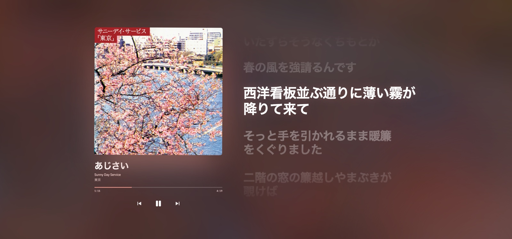
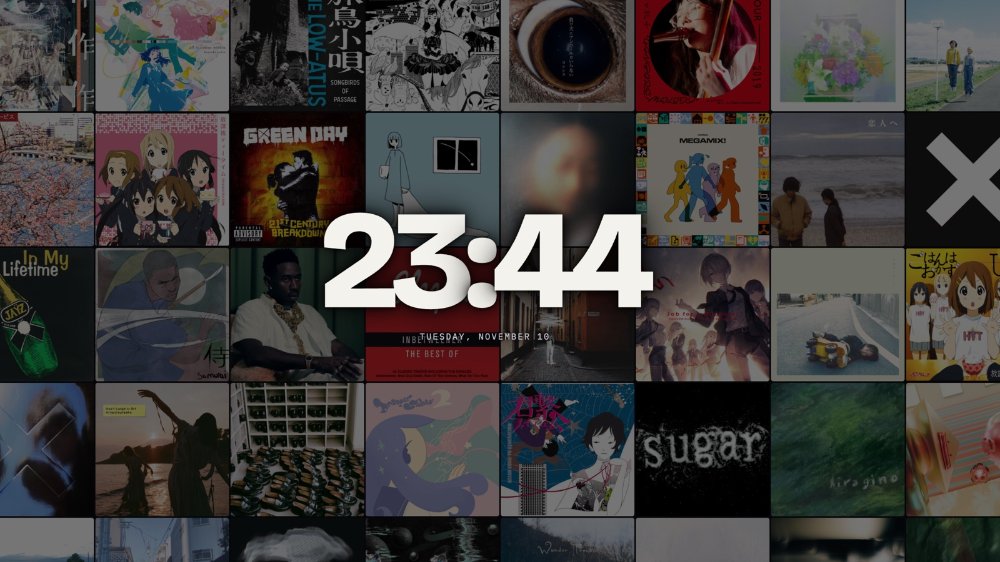

# spotify-calendar

Your Spotify listening history as a calendar of album covers, plus a Now Playing screen that takes on the colour of the album and scrolls synced lyrics.





- **Calendar** — every day is a tile made of the albums you played. Pick a day to see its albums, tracks and when you listened. Albums you played start to finish get a disc badge.
- **Year** — twelve small months on one page, each day showing its most played album.
- **Full albums** — a shelf of every album you played start to finish.
- **Recap** — one sheet per month: most played album, listening time, full albums, busiest hour.
- **Little extras** — a colour strip showing how the month moved, "3 days in a row" and "a year ago today" notes on each day.
- **Now Playing** — the cover's dominant colour drives the whole screen; lyrics follow the song. Press `F` for fullscreen.
- **Standby** — left in fullscreen with nothing playing, it becomes a clock over a wall of your most played album covers.
- **Yours** — it runs on your machine with your own Spotify app. Nothing is sent anywhere except Spotify and [LRCLIB](https://lrclib.net) (track and artist names, to find lyrics).

## About your history

Spotify only exposes your last 50 plays, so history builds up **from the moment you start running this**, and only while it is running.

To fill in the past, request your **Extended streaming history** at <https://www.spotify.com/account/privacy/> and load the `Streaming_History_Audio_*.json` files on the app's **Import history** page. Each track is looked up on Spotify for its artwork, so a large history takes a while (it runs in the background and never adds a play twice).

## What you need

- A Spotify account. Spotify currently requires the owner of a developer app to have **Premium**; playback controls in the app need Premium too.
- Docker, or Node.js 24+.

## 1. Create a Spotify app

1. Open <https://developer.spotify.com/dashboard> and create an app.
2. Tick **Web API**.
3. Add the Redirect URI `http://127.0.0.1:8787/auth/callback` (it must be `127.0.0.1`, not `localhost`).
4. Copy the **Client ID** and **Client secret** from the app's settings.

## 2. Configure

```sh
git clone https://github.com/kongchu2/spotify-calendar.git
cd spotify-calendar
cp .env.example .env      # then put your Client ID and secret in .env
```

## 3. Run

### With Docker

```sh
docker compose up -d --build
```

Open <http://127.0.0.1:8787> and click **Connect Spotify**. Your history lives in the `listening-data` Docker volume and survives restarts and rebuilds.

### With Node

```sh
npm ci
npm run build
npm start
```

Open <http://127.0.0.1:8787>. The database is `data/listening.db`.

Leave it running: plays are collected every 2 minutes.

## Development

```sh
npm install
npm run dev               # http://127.0.0.1:5180, API on :8787
```

- `server/` — Hono API, Spotify client, collector, SQLite (`node:sqlite`).
- `src/` — React app. `src/color.ts` extracts the point colour from the cover in the browser.

## Running on a server

The server listens on `127.0.0.1` only. To reach it from other devices, put it behind something that provides **HTTPS and access control** (a private network such as Tailscale, or a reverse proxy with authentication) — anyone who can reach the API can control your playback.

- Spotify requires HTTPS for non-loopback redirect URIs. Either register `https://your-host/auth/callback` in the Spotify dashboard and set `SPOTIFY_REDIRECT_URI`, or sign in once on your own machine and copy `data/listening.db` to the server.
- Example systemd units are in `deploy/systemd/`.

### Optional: archive your history to a git repository

`server/worker.ts` is a standalone collector that also publishes every play to a separate git repository as JSON Lines (`plays/YYYY-MM.jsonl`), pushing at most every 15 minutes, and restores the database from it on start. To use it, run the web server with `COLLECT=0`, run `npm run worker` alongside it, and set `DATA_REPO_DIR` to a clone of your archive repository that can push.

## Optional: Spotify's own lyrics (sidecar)

LRCLIB does not have every track. `lyrics-sidecar/` is a small Rust program that
signs in as a Spotify client (via [librespot](https://github.com/librespot-org/librespot))
and serves Spotify's own, usually line-synced, lyrics on localhost; the server
uses them first and falls back to LRCLIB. It needs Rust and a one-time sign-in.

```sh
cd lyrics-sidecar
cargo build --release
./target/release/lyrics-sidecar --login     # opens a browser; authorise once
```

Then set `SPOTIFY_LYRICS_URL=http://127.0.0.1:8899` in `.env` and run the binary
alongside the server (an example systemd unit is in `deploy/systemd/`).

This uses an undocumented Spotify endpoint through a real client login, so it is
a gray area under Spotify's terms, stores a reusable account credential on disk
(`data/spotify/credentials.json`), and can break if Spotify changes things. It is
off unless `SPOTIFY_LYRICS_URL` is set.

## Configuration

| Variable | Default | Purpose |
| --- | --- | --- |
| `SPOTIFY_CLIENT_ID`, `SPOTIFY_CLIENT_SECRET` | — | Your Spotify app's credentials (required) |
| `SPOTIFY_REDIRECT_URI` | `http://127.0.0.1:$PORT/auth/callback` | Must match a Redirect URI registered in the dashboard |
| `PORT` | `8787` | Port the server listens on |
| `HOST` | `127.0.0.1` | Address the server binds to |
| `DB_PATH` | `data/listening.db` | SQLite database file |
| `COLLECT` | on | Set to `0` to stop the web server from collecting (when the worker does it) |
| `DATA_REPO_DIR` | — | Archive repository clone used by the worker |
| `ARCHIVE_PUSH_MINUTES` | `15` | Minimum minutes between archive pushes |

## License

[MIT](LICENSE)
